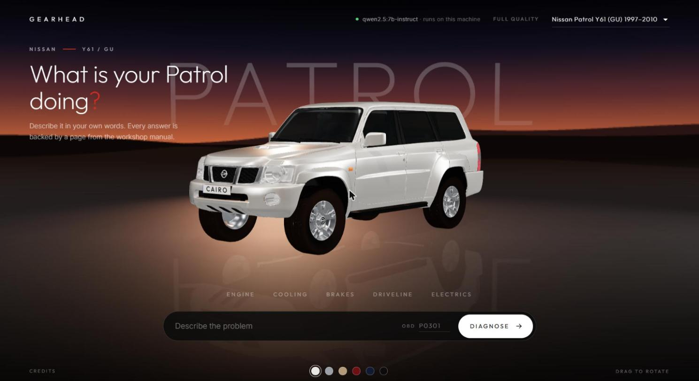

<!-- markdownlint-disable MD033 -->
<div align="center">

# 🚗 GEARHEAD

**A local-first AI assistant that diagnoses car problems and gives the exact fix — grounded in real workshop manuals, with the diagram and the page it came from.**

Python · FastAPI · Retrieval-Augmented Generation · Multimodal LLM · Ollama · ChromaDB · PyMuPDF



</div>

---

## What it does

Tell GEARHEAD what's wrong — in plain words (*"my brakes shudder when I slow down"*) or as an OBD fault code — and it interviews you like a mechanic, one question at a time, then returns a **grounded, cited fix**: the steps, the real labelled diagram from the service manual, and the exact page it came from.

It runs locally. In Claude mode the only thing that leaves your machine is the call to the language model — and in **Ollama mode, nothing leaves at all**: the whole pipeline runs offline on your own GPU, for free.

### Why it's built this way
- **Grounded, not guessed.** Every answer is retrieved from real manuals and cites its source page. If the manuals don't cover it, GEARHEAD says so instead of hallucinating — because a wrong car repair is a safety risk.
- **Reads diagrams.** Manual pages are rendered to images and, in Claude mode, passed to a multimodal model that interprets labelled engineering diagrams (e.g. distinguishing a front vs. rear brake caliper schematic). Ollama mode still renders and shows the cited diagram pages — captioned from the manual's own metadata instead of vision.
- **Add a car = drop a PDF.** The ingestion pipeline is car-agnostic; the hero car is the Nissan Patrol (Y61), the most common vehicle across the Gulf region.

---

## How it works

```
        You (browser, car-dashboard UI)
                     │
        ┌────────────▼─────────────┐
        │   FastAPI backend         │   runs the interview loop
        └─────┬───────────────┬─────┘
              │               │
   ┌──────────▼─────┐   ┌─────▼──────────────┐
   │  The Library   │   │   The Brain (LLM)   │
   │  Chroma vector │   │  reasons + reads    │
   │  DB of manuals │   │  diagrams (vision)  │
   └──────────▲─────┘   └─────────────────────┘
              │
        📂 /manuals  ← service-manual PDFs you drop in
```

**Pipeline**
1. **Ingest** — service-manual PDFs are parsed (PyMuPDF), chunked, embedded, and stored in a local Chroma vector database (22 Patrol manuals → ~2,450 indexed chunks).
2. **Retrieve** — a wide vector search over the manuals, then a small local cross-encoder re-reads the question against each candidate and puts the best pages first.
3. **Gate** — if no manual page is a good match, GEARHEAD says so and asks for more detail instead of guessing. A vague complaint gets a second look first: the model names the part it is about, and the question goes ahead if the manual covers that part.
4. **Interview** — the model asks the smartest next question to narrow the diagnosis, looping until it's confident.
5. **Diagnose** — it returns a cited fix: steps + the rendered manual diagram + source page.

**Engineering highlights**
- **Swappable model interface** (`AIProvider`) — the underlying LLM is pluggable behind a clean interface: the cloud Claude API (vision + prompt caching) or a fully local Ollama model, switched with a single env var.
- **Prompt caching** across the system + retrieved-context block cuts repeated per-turn token cost by ~90%.
- **Measured, not assumed.** An evaluation harness (`eval/`) scores retrieval, citation grounding and refusals on 142 questions. It showed the original query-expansion step was hurting page retrieval (41% in the top 6), and that reranking lifts it to 69%. It also showed the local model writing repair steps for parts the car does not have, which led to a coverage gate that stops 26 of 30 of those questions. A held-out test then showed the gate is weaker than that: it stopped only 10 of 17 fresh ones, mostly missing questions about a different make of car. A name check for other vehicles now lifts that to 14 of 17, with known gaps (nicknames, other Patrol generations) recorded in eval/README.md. A question that names another vehicle now gets one short model call to decide which vehicle it is about: on 48 fresh questions it declined all 12 about another vehicle that mentioned the Patrol, and wrongly declined 8 of 24 about the Patrol. See [eval/README.md](eval/README.md).
- **End-to-end tested** via FastAPI's `TestClient` (full flow + diagram serving).

---

## Tech stack

| Layer | Tool |
|---|---|
| Backend / web | Python, FastAPI |
| Retrieval | ChromaDB (local vector store) |
| PDF + image extraction | PyMuPDF |
| Reasoning + vision | Claude API (vision) **or** local Ollama (offline, free) behind a pluggable `AIProvider` |
| Frontend | HTML / CSS / vanilla JS with three.js: the selected car in 3D, a backdrop per car, and a camera that moves to the part being discussed |

---

## Project status

**Working end-to-end:** manual ingestion + search, grounded cited diagnosis, the interview loop, diagram rendering, a FastAPI web app with a 3D showroom front end — and a **fully offline Ollama mode** (no API key, no cost).

**Next:** prove "add a car = drop a PDF" with a second vehicle.

---

## Running it locally

```bash
# 1. create + activate a virtual environment
python -m venv .venv
.venv\Scripts\activate          # Windows  (use source .venv/bin/activate on macOS/Linux)

# 2. install dependencies
pip install -r requirements.txt

# 3. add your model API key to a local .env file (see .env.example)
#    — or skip the key entirely and use Ollama mode (below)

# 4. drop service-manual PDFs into /manuals, then build the search index
python ingest_manuals.py

# 5. launch the app
python run_app.py               # → http://127.0.0.1:8000
```

### Running it 100% free & offline (Ollama)

No API key, no cloud, no cost — the brain runs on your own machine:

```bash
ollama pull qwen2.5:7b-instruct   # once (any 7–8B instruct model works)
```

Then in your `.env`:

```ini
GEARHEAD_PROVIDER=ollama
GEARHEAD_OLLAMA_MODEL=qwen2.5:7b-instruct
```

With no `ANTHROPIC_API_KEY` set, GEARHEAD picks Ollama automatically. The UI's engine badge shows which brain is under the hood. Runs comfortably on an 8 GB GPU.

See **BLUEPRINT.md** for the full design rationale and build log.

---

## Project layout

```
gearhead/
├── BLUEPRINT.md          # design + build log
├── requirements.txt
├── ingest_manuals.py     # build the manual search index
├── run_app.py            # launch the web app
├── manuals/              # service-manual PDFs (git-ignored — see note below)
└── src/
    ├── config.py         # keys + paths
    ├── ai/               # swappable AIProvider interface + implementations
    ├── library/          # manual ingestion, search, image rendering
    ├── brain/            # diagnosis + interview engine
    └── web/              # FastAPI server + 3D showroom UI (static/showroom.js, static/cars/cars.json)
```

---

## Credits

- **3D engine:** [three.js](https://threejs.org) r170, MIT licence. A copy is kept in `src/web/static/vendor/three` so the app runs offline.
- **3D car model:** "Nissan Patrol (Y61) 5door 2004" by Nieve5677 on [Sketchfab](https://skfb.ly/pvJSp), listed as Creative Commons Attribution 4.0. The model file is not in this repository. To see the car, download it yourself and save it as `src/web/static/cars/nissan-patrol-y61.glb`. Without it the app draws a plain stand-in.
- **Fonts:** Outfit and Inter, SIL Open Font License, loaded from Google Fonts.
- **Reranker:** ms-marco-MiniLM-L-12-v2, run through flashrank.

## ⚠️ Disclaimer & legal note

GEARHEAD is a personal/educational project. Its output is **not a substitute for a qualified mechanic** — every diagnosis carries a *"always verify with a professional"* warning, and the system is designed to refuse to guess when the manuals don't cover a problem.

Service manuals are copyrighted. **No manuals are included in this repository** — the `manuals/` directory and `.env` are git-ignored. Users supply their own PDFs locally for personal use.
